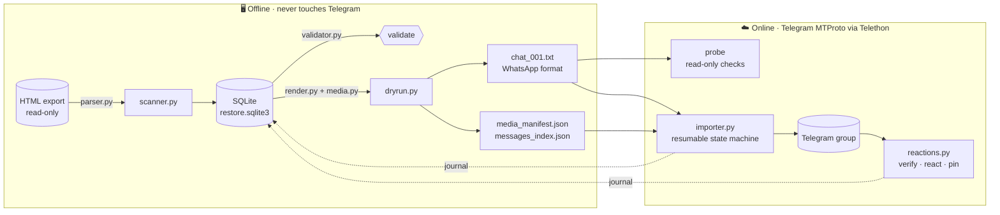
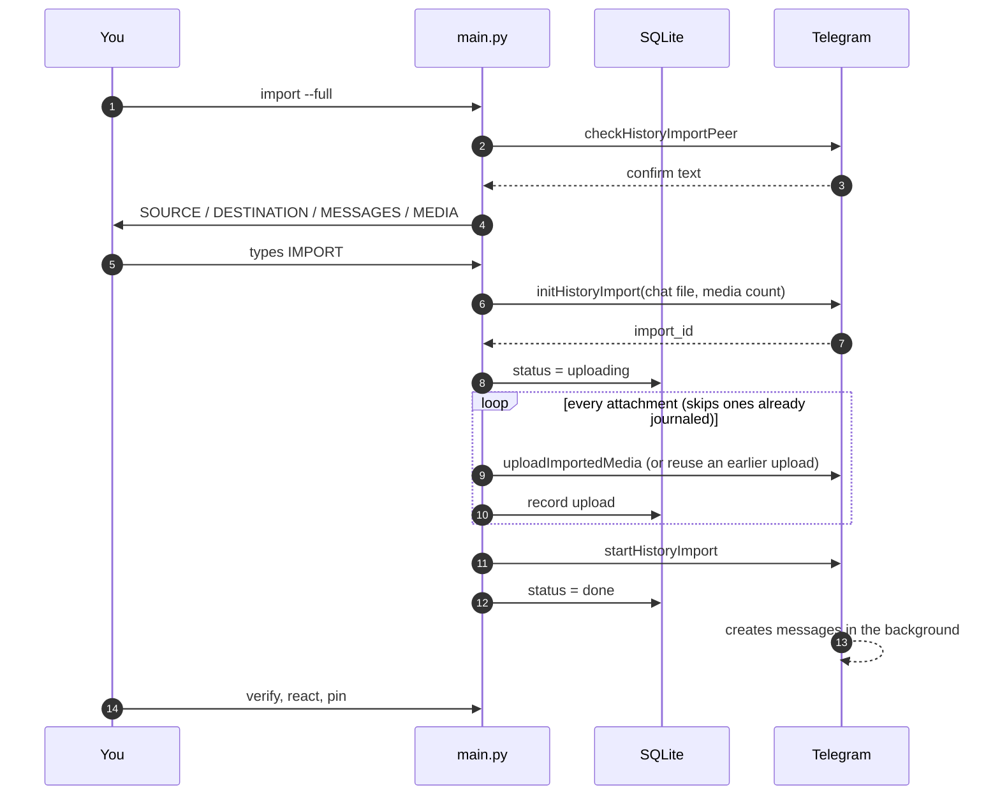
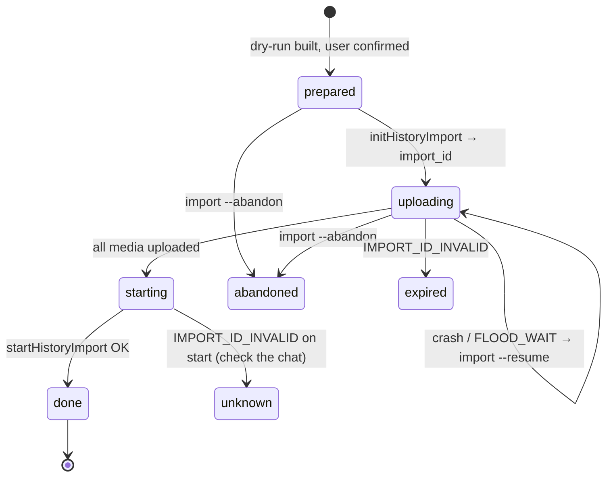
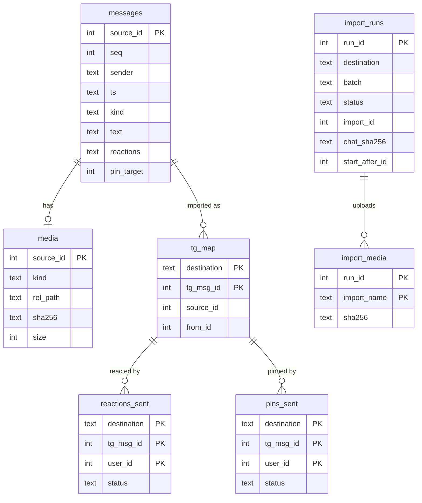

<div align="center">

# 💬 telegram-chat-reconstructor

**Lost a Telegram chat but kept the export? Bring it back — for real.**

Rebuilds a Telegram Desktop HTML export inside Telegram with original dates, real senders, real media,
and everyone's own reactions & pins — using only Telegram's official
[history-import API](https://core.telegram.org/api/import).

[](https://www.python.org/)
[](https://github.com/LonamiWebs/Telethon)
[](#-development)
[](LICENSE)


[Quick start](#-quick-start) · [Run it](#-running-it) · [System design](#-system-design) · [Internals](#-implementation-deep-dive) ·
[Guide](#-step-by-step-guide) · [Limits](#-known-telegram-behaviours) · [FAQ](#-faq)

</div>

---

## ⚡ TL;DR

```bash
python main.py scan && python main.py dry-run     # offline: parse + build
python main.py create-group --title "Our chat"     # empty import-ready group (add members!)
python main.py import --full                       # upload media, start the import
python main.py verify                              # what made it, what Telegram dropped
python main.py react && python main.py pin         # your own reactions & pins, natively
```

No fake accounts. No impersonation. No third-party servers. Runs 100 % locally under your own login. 🔒

---

## ✨ What you get

| From the export | In Telegram | |
|---|---|:-:|
| Text, emoji, line breaks, order | Native messages | ✅ |
| Who sent it | The real member account | ✅ |
| Original date & time | On every message — and on the real timeline in a fresh import group | ✅ |
| Photos, videos, files, audio, voice notes | Native media | ✅ |
| Stickers (`.webp`, `.webm`) | Native stickers | ✅ |
| Animated stickers (`.tgs`) | Rendered locally to video stickers | ✅ |
| Reactions | Re-added by **each person from their own account** | ✅ |
| Pins | Re-pinned by **each person from their own account**, "pinned" lines cleaned up | ✅ |
| Replies, forwards, calls, self-destructing media, albums | Short notes like `[↩ Reply to Name, 30.03.2025 17:50:50: "…"]` | 📝 |
| GIFs | Arrive as short videos | ⚠️ |
| Telegram's tiny **"Imported"** label | Can't be removed — Telegram adds it | ❌ |
| Real reply links, forward headers, original message IDs | Not possible with the import API | ❌ |

> **Real numbers:** on a 247k-message export, 99.9 % of messages and 100 % of media landed, all on their
> original dates. The ~0.1 % Telegram silently drops is listed by `verify`.

---

## 🧠 System design

### Architecture

The pipeline is split into an **offline half** (deterministic, no network, safe to re-run) and an
**online half** (talks to Telegram, every step journaled in SQLite so it can resume).



### Import flow

Telegram only imports chats from *other* apps, so the export is converted into a WhatsApp-format chat
file. Nothing is visible in the chat until `startHistoryImport` succeeds.



### Import run state machine

Every chunk is a row in `import_runs`. Each transition is committed the moment it happens, so a crash at
any point is recoverable and a started import is never started again.



### Data model



### Design decisions

<details>
<summary><b>Why convert to WhatsApp format?</b></summary>

Telegram's import API only accepts exports from other messengers. The WhatsApp line grammar
(`[DD/MM/YYYY, HH:MM:SS] Name: text`) is accepted for private chats and, with a "created group" header
line, for groups. `probe` asks Telegram (read-only) whether a generated file is recognised before
anything is written.
</details>

<details>
<summary><b>Why SQLite as a journal?</b></summary>

A full import uploads tens of thousands of files over hours. Every upload, state change, reaction and pin
is committed before moving on, so crashes, sleep, `FLOOD_WAIT`s and Ctrl+C are all just "resume later".
Duplicate protection is enforced by data, not by hope: a second `--full` into the same chat, or a chat
file identical to one already imported, is refused.
</details>

<details>
<summary><b>How are imported messages matched back to the source?</b></summary>

Imported messages carry their original timestamp in `fwd_from.date`. `dry-run` writes
`messages_index.json` (source id + timestamp per chat line, in order); `verify`, `react` and `pin` walk the
chat and the index together, pairing by order and timestamp. The mapping is cached in `tg_map` once the
import has fully landed.
</details>

<details>
<summary><b>Why does each person re-add their own reactions and pins?</b></summary>

Because anything else would be impersonation. The tool only ever acts as the logged-in account. The other
participant logs in themselves with a separate session (`--session work/other --logout`).
</details>

<details>
<summary><b>Why upload repeated media only once?</b></summary>

Files are hashed (SHA-256). After the first upload, later attachments with the same hash reuse the
uploaded document instead of sending the bytes again — in practice ~80 % of attachments were reuses.
</details>

---

## 🔬 Implementation deep dive

How each stage works, with the actual rules the code follows. File names link the concepts to the code.

<details>
<summary><b>1 · Parsing the HTML export</b> — <code>parser.py</code></summary>

- Reads `messages.html`, `messages2.html`, … in numeric order with **lxml**; every `div.message` becomes a
  normalized `Message` (`models.py`).
- **Timestamps** come from the `title` attribute (`30.03.2025 17:50:50 UTC+05:30`) and keep their UTC offset.
- **"Joined" blocks** (consecutive messages from the same person) carry no name in the HTML; the sender is
  inherited from the previous block.
- **Replies** and **pins** are resolved from `#go_to_message123` links; **forwards** keep the original author
  and date; **reactions** keep the emoji and every reacting person's name.
- **Text** is rebuilt with `<br>` as newlines plus formatting entities (bold, italic, code, strike, spoiler,
  links) as character offsets.
- **Media type** is decided from the export's CSS classes (`photo_wrap`, `video_file_wrap`, `animated_wrap`,
  `media_voice_message`, …) and, for stickers, the file extension (`.tgs` animated, `.webm` video).
- A broken block never stops the scan: it is recorded in `parse_errors` and reported by `validate`.
</details>

<details>
<summary><b>2 · Scanning into SQLite</b> — <code>scanner.py</code>, <code>media.py</code>, <code>database.py</code></summary>

- Every referenced file is resolved **inside** the export only (paths escaping it are rejected), then
  hashed with **SHA-256** and type-sniffed by **magic bytes** — once per physical file, however often it is
  referenced.
- **"Sent together"**: the HTML export doesn't record albums, so adjacent photo/video blocks from the same
  sender in the same second are marked as a group and labelled `[Sent together: 2/5]`.
- Each message gets a `content_hash`; duplicates are a validation error.
- The database is **rebuilt atomically**, and rebuilding is refused once any import has started (it would
  break resume and auditing).
</details>

<details>
<summary><b>3 · Validation</b> — <code>validator.py</code></summary>

Blocking errors: parse failures, IDs or timestamps going backwards, messages without sender/time, sender
names that would break the chat-line grammar, duplicate import file names, duplicate content hashes.
Warnings/info: missing or mismatched media files, zero-byte files, unknown content, >4096-char texts,
replies/pins pointing outside the export, continuation lines that need escaping.
</details>

<details>
<summary><b>4 · Rendering the chat file</b> — <code>render.py</code></summary>

Each message becomes WhatsApp-style lines:

```text
[29/03/2025, 17:50:49] Our chat: ‎Alice created group “Our chat”     ← group header (groups only)
[30/03/2025, 17:50:50] Alice: Hey!
[30/03/2025, 17:56:59] Bob: ‎<attached: 00013082-PHOTO-2025-03-30-17-56-59.jpg>
[30/03/2025, 17:56:59] Bob: [↩ Reply to Alice, 30.03.2025 17:50:50: "Hey!"]
To this.
```

Rules, most of them learned from the live API:

| Rule | Why |
|---|---|
| Attachment line stands alone; caption/notes follow as a new message with the same time | Text after an attachment makes Telegram drop the media |
| Unique attachment name `<source_id>-<TYPE>-<timestamp>.<ext>` | Each line maps to exactly one uploaded file |
| Split at **2,000** chars (single-line) / **1,200** chars (multi-line) | Longer messages are silently dropped |
| Empty lines → invisible word joiner `U+2060` | Messages with empty lines are lost |
| Continuation lines that look like `[dd/mm/yyyy, hh:mm…` get a leading word joiner | Otherwise parsed as a new message |
| Trailing whitespace stripped | Invisible, avoids parser edge cases |
| `plain` formatting keeps text exact and appends hidden link targets; `whatsapp` adds `*bold*` `_italic_` `~strike~` | The importer doesn't carry entities |
| Notes for replies, forwards, calls, self-destructing media, albums (`ANNOTATE`) | No native equivalent in an import |

The renderer also records `(line, source_id)` for every message start — the key to matching later.
</details>

<details>
<summary><b>5 · Dry run artifacts</b> — <code>dryrun.py</code></summary>

- `chat_NNN.txt` — split into chunks by size (`--max-chunk-mib`, default 30), **only at message starts**.
- `media_manifest.json` — every attachment with its chunk, hash, size and *upload spec*.
- `messages_index.json` — `[source_id, original timestamp]` per chat line, in order.
- `plan.json` — counts, unique media bytes, warnings (e.g. chunks above the 32 MiB Android client limit).

Output is deterministic: the same database and options produce byte-identical files.
</details>

<details>
<summary><b>6 · Upload specs and sticker conversion</b> — <code>media.py</code>, <code>importer.py</code></summary>

| Kind | Sent as |
|---|---|
| Photo (JPEG/PNG) | `InputMediaUploadedPhoto` |
| Video | Document `video/mp4`, real width/height/duration probed with hachoir, streaming flag |
| GIF | Document `video/mp4` + animated attribute (Telegram shows it as a video) |
| Sticker `.webp` / video sticker `.webm` | Document with sticker attribute (+ 512×512 video attribute for `.webm`) |
| Animated sticker `.tgs` | Rendered with **rlottie** to PNG frames (≤ 3 s, 30 fps), encoded by **ffmpeg** to VP9 + alpha `.webm`, cached in `work/converted/<sha>.webm`, sent as a video sticker |
| Voice / audio | Document with audio attribute (voice flag, duration, title) |
| Anything else | Document with its guessed MIME type and original file name |
</details>

<details>
<summary><b>7 · The importer state machine</b> — <code>importer.py</code></summary>

- **Guards first:** refuses basic groups, a second `--full` into the same destination, and a chat file whose
  SHA-256 was already imported there.
- `initHistoryImport` → `import_id` is stored, then each attachment goes through `uploadImportedMedia`.
- **Upload reuse:** after a file is uploaded once, later attachments with the same SHA-256 send the
  already-uploaded `InputDocument` / `InputPhoto` instead of the bytes (~80 % of attachments in practice).
  If Telegram ever rejects reuse, it falls back to fresh uploads automatically.
- Every upload is committed to `import_media` before the next one, so `--resume` skips exactly what's done.
- `startHistoryImport` runs once; `start_after_id` (the newest message id before the import) is recorded so
  later matching ignores older messages.
- `--test` picks a ~40-message sample automatically: the first message of every media and note type, replies,
  forwards, each person's reactions and pins with their targets, formatted / multi-line / very long texts,
  photos with and without captions, and one "sent together" group.
- A JSON report (counts, reuse stats, flood waits, duration) is written next to the batch.
</details>

<details>
<summary><b>8 · Matching imported messages back to the source</b> — <code>reactions.py</code></summary>

Telegram gives imported messages new IDs but keeps the original time in `fwd_from.date`. `match()` walks
the chat (oldest first, after `start_after_id`) and `messages_index.json` together with two pointers:

```text
for each imported message (id, original_date):
    advance in the index until an entry with the same timestamp is found
    pair them; entries skipped over are messages Telegram dropped
```

- `my_export_name()` figures out which export name *is* the logged-in account by majority vote over the
  paired messages' real sender IDs — no name guessing.
- `first_tg_ids()` maps each source message to its first Telegram message (the attachment, or the first
  part of a split text) — that's where reactions and pins go.
- The mapping is cached in `tg_map` once at most 1 % is missing, so `react` and `pin` don't re-read
  hundreds of thousands of messages each time.
</details>

<details>
<summary><b>9 · Reactions, pins and verify</b> — <code>reactions.py</code></summary>

- **Reactions:** only emojis whose actor list contains *this* account's export name. Tries all emojis at once
  (Premium allows several), then the first one with and without the emoji variation selector, because export
  and server spellings differ. Sent with `add_to_recent=False`. Stops after 20 failures in a row.
- **Pins:** this account's pins in original order (a message pinned twice uses its latest pin), sent silently;
  the `MessageActionPinMessage` service messages returned by Telegram are deleted right away. Missing pin rights
  stop the run with a clear message.
- **Verify:** pairs everything, then reports unmatched index entries with date, sender, type, length and
  split part — never the text.
- Results go to `reactions_sent` / `pins_sent` keyed by (destination, message, user): rerunning sends only
  what's missing or failed.
</details>

<details>
<summary><b>10 · Rate limits</b> — <code>telegram_api.py</code></summary>

`call_with_flood()` wraps every write: on `FLOOD_WAIT_X` it sleeps `X + 1` seconds if `X ≤ --max-flood-wait`
(default 900), up to 3 times per request; otherwise it raises `FloodStop`, which the importer turns into a
clean stop with progress saved. The importer disables Telethon's own auto-sleep so every wait goes through
this one policy.
</details>

<details>
<summary><b>11 · Testing strategy</b> — <code>tests/</code></summary>

- `conftest.py` builds tiny **synthetic** Telegram exports on the fly — no real chats in the repo.
- Parser, ordering, rendering, media specs, config and database are unit-tested directly.
- The importer runs end-to-end against a **fake Telegram client**: full flow, upload reuse + fallback,
  flood-wait stop and resume, duplicate refusal, abandon.
- Matching, reaction/pin planning, emoji fallbacks and the missing-message report have their own tests.
</details>
---

## 🧰 Requirements

- 🐍 Python **3.11+** (Windows, macOS, Linux)
- 🔑 API credentials from [my.telegram.org](https://my.telegram.org) → *API development tools*
- 📦 A chat exported from **Telegram Desktop** → ⋮ → *Export chat history* → format **HTML**, media included
- 📶 Upload bandwidth + patience for big media libraries ([timings](#-how-long-it-takes))

## 🚀 Quick start

> 🤖 **Prefer an AI to walk you through it?** Give [`AI_SETUP.md`](AI_SETUP.md) to your coding assistant
> (Cursor, Claude Code, Copilot…) with: *"Read AI_SETUP.md and follow it exactly."*

```bash
git clone https://github.com/KrishnaGupta653/telegram-chat-reconstructor.git
cd telegram-chat-reconstructor
python -m venv .venv
# Windows: .venv\Scripts\activate    ·    macOS/Linux: source .venv/bin/activate
pip install -r requirements.txt
cp .env.example .env                 # Windows: copy .env.example .env
```

```ini
# .env
TG_API_ID=1234567
TG_API_HASH=0123456789abcdef0123456789abcdef
EXPORT_DIR=/path/to/ChatExport_YYYY-MM-DD
WORK_DIR=work
DESTINATION=                          # filled in after create-group
ANNOTATE=replies,forwards,service,calls,ttl,albums
```

Every command that changes something in Telegram shows a summary and makes you type a confirmation word.
No surprises. 🙅

---

## 🏃 Running it

### First login

The first command that talks to Telegram (`probe`, `create-group` or `import`) logs you in interactively:

```text
Please enter your phone (or bot token): +15551234567
Please enter the code you received: 12345
Please enter your password:            # only if you use two-step verification
Signed in successfully as Your Name
```

The session is saved to `work/telegram.session` (or `TG_SESSION`), so you only do this once. Treat that file
like a password — it is git-ignored and never leaves your machine.

### What a write looks like

Nothing changes in Telegram until you type the confirmation word:

```text
──────────────────────────── CONFIRM IMPORT ────────────────────────────
SOURCE       /path/to/ChatExport_YYYY-MM-DD
DESTINATION  group Our chat (id 1234567890)
MESSAGES     247,569 in 1 import file(s) [full-ios-20261002-171137, format ios]
MEDIA        24,549 attachments, 4,583 unique files (1,492.9 MiB)

Imported messages will appear at the time and date when they were sent.
Type IMPORT to continue: IMPORT
chat_001.txt media ━━━━━━━━━━━━━━━━━━━━━━━━━━━━━━━━━━━━━━ 24549/24549 0:00:00
Import started for all chunks. Telegram processes it in the background.
Report: work/imports/full-ios-20261002-171137/import_report.json
```

…and checking the result:

```text
─────────────────────────────── VERIFY ───────────────────────────────
FOUND        247,324 of 247,568 chat lines
MISSING      244: text 204, long text 40
  2025-04-01T12:11:10  Name A        text        103 chars
  2025-04-10T01:56:53  Name B        text        795 chars
  ... and 242 more
Full list (dates and sizes only): work/verify_report.json
```

### Long runs

A big import uploads for hours. Keep the machine awake and log the output:

| OS | Keep awake + log |
|---|---|
| Windows (PowerShell) | `powercfg /change standby-timeout-ac 0` then `python main.py import --full 2>&1 \| Tee-Object import.log` |
| macOS | `caffeinate -i python main.py import --full 2>&1 \| tee import.log` |
| Linux | `systemd-inhibit python main.py import --full 2>&1 \| tee import.log` |

Check progress from a second terminal with `python main.py status` (offline, reads SQLite).

### Stop and resume — anytime

| You want to… | Do this | What happens |
|---|---|---|
| Pause an upload | `Ctrl+C` | Every finished upload is already journaled |
| Continue it | `python main.py import --resume` | Same Telegram import session, skips uploaded files |
| Throw it away (before it started) | `python main.py import --abandon` | Nothing was ever visible in the chat |
| Pause reactions / pins | `Ctrl+C` | Each sent reaction / pin is journaled |
| Continue them | run `react` / `pin` again | Skips everything already done |

> Don't leave an *unstarted* import paused for many hours — Telegram may expire its session
> (`IMPORT_ID_INVALID`), which means uploading again. Reactions and pins never expire.

### Rules of thumb

- **One command at a time per session.** Two processes on the same session file → `database is locked`.
- **Second person = second session.** They run `react` / `pin` with `--session work/other` and log in
  with *their* phone; add `--logout` to remove that session from your machine afterwards.
- **Don't delete messages in the group** between `import` and `react` / `pin` — the saved message mapping
  points at them.
---

## 🗺️ Step-by-step guide

<details open>
<summary><b>1 · Parse and check the export</b> — offline</summary>

```bash
python main.py scan        # export → work/restore.sqlite3 + census
python main.py validate    # consistency checks (non-zero exit on blockers)
python main.py dry-run     # work/dry_run/<run>/chat_001.txt + manifests
```
The export folder is only ever read.
</details>

<details>
<summary><b>2 · Ask Telegram if it accepts the file</b> — read-only</summary>

```bash
python main.py probe
```
First run logs you in; the session stays local in `work/`.
</details>

<details>
<summary><b>3 · Test import in a throwaway group</b></summary>

```bash
python main.py create-group --title "import test"   # → DESTINATION=<id> in .env, add the other person
python main.py import                                # ~40 messages covering every content type
```
Check photos, stickers, long messages and notes, then delete the test group.

> ⚠️ Don't test in your real group: original dates only stick when the full history lands in an
> **empty** group as a single import.
</details>

<details>
<summary><b>4 · Create the real group and add everyone</b></summary>

```bash
python main.py create-group --title "Our chat"       # → DESTINATION=<id>
```
Add every participant **before** importing (Telegram maps names in the file to members). Give them
*Pin messages* rights if they'll restore their pins.
</details>

<details>
<summary><b>5 · Import everything</b></summary>

```bash
python main.py import --full
python main.py status            # offline progress
python main.py import --resume   # after any interruption — uploaded files are skipped
```
After the upload, Telegram keeps creating messages in the background for a while.
</details>

<details>
<summary><b>6 · Verify</b> — read-only</summary>

```bash
python main.py verify
```
Lists every source message Telegram didn't create (dates & sizes only, no text) →
`work/verify_report.json`. Re-run until the count stops changing.
</details>

<details>
<summary><b>7 · Reactions & pins — everyone from their own account</b></summary>

```bash
python main.py react --dry-run && python main.py react
python main.py pin   --dry-run && python main.py pin

# the other person, logged in as themselves:
python main.py react --session work/other
python main.py pin   --session work/other --logout
```
Resumable, never sends twice, only ever acts as the logged-in account.
</details>

---

## 📖 Command reference

| Command | Telegram? | What it does |
|---|:-:|---|
| `scan` | — | Parse the HTML export into SQLite, print a census |
| `validate` | — | Consistency checks on parsed data |
| `dry-run [--format ios\|android] [--formatting plain\|whatsapp] [--utc-offset +HH:MM] [--max-chunk-mib N]` | — | Build chat file(s) + media manifest |
| `probe [files…] [--peer]` | 👀 | Is the format / destination accepted? |
| `create-group --title T [--about A]` | ✍️ | Empty supergroup flagged for import |
| `upgrade-group [--peer]` | ✍️ | Basic group → supergroup |
| `import [--test\|--full\|--resume\|--abandon]` | ✍️ | Run / resume / discard an import |
| `status` | — | Import runs & upload progress |
| `verify [--batch]` | 👀 | What's missing from the destination |
| `react` / `pin` `[--dry-run] [--session S] [--logout] [--pace s]` | ✍️ | This account's own reactions / pins |

— offline · 👀 read-only · ✍️ writes (asks first). Global: `--env path/to/.env`. Details: `python main.py <cmd> -h`.

---

## ⏱️ How long it takes

Measured on a real export: **~247k messages, ~24.5k attachments (4.6k unique files, 1.5 GB)**, ~0.25 MB/s uplink.

| Phase | Time | Bottleneck |
|---|---|---|
| `scan` + `dry-run` | minutes | disk / CPU |
| Media upload | ~5 h | your upload speed (repeats are reused) |
| Telegram creating messages | ~20 min | Telegram |
| `verify` | ~45 min | Telegram history read limits |
| `react` | ~25 per 5 min | Telegram flood limits — thousands take ~a day |
| `pin` | similar | Telegram flood limits |

Keep the machine awake and online. Everything stops and resumes cleanly. 😴➡️▶️

---

## 🧪 Known Telegram behaviours

Found by testing against the live API — none of it is documented by Telegram.

<details>
<summary><b>Show all findings</b></summary>

- 📅 **Original dates:** the first import into an empty `create-group` group put messages on their real
  dates. Later imports into a non-empty or upgraded group showed the import date.
- 👥 **Groups must be supergroups.** Basic groups fail with `PEER_ID_INVALID` → `create-group` / `upgrade-group`.
- 📎 **Attachments must stand alone.** Text after an attachment line makes Telegram drop the media, so
  captions become a separate message with the same timestamp.
- ✂️ **Long messages vanish silently.** Messages are split at 2,000 chars (single-line) / 1,200 chars (multi-line).
- ⬜ **Empty lines** inside a message make it disappear → written as an invisible word joiner.
- 🎞️ **`.tgs` and `image/gif` uploads are ignored.** Animated stickers are rendered to VP9 `.webm`;
  GIFs go up as MP4 and arrive as videos.
- 🕳️ **~0.1 % of messages are dropped anyway**, mostly plain text, with no error. `verify` lists them.
- ⏳ **Imports finish in the background**, and a new import into the same chat is blocked for ~5 min
  (`PREVIOUS_CHAT_IMPORT_ACTIVE_WAIT_XMIN`).
- 📦 **Very large exports:** chat files over `--max-chunk-mib` (default 30 MiB) are split into several imports;
  only the first is likely to keep original-date placement, and each later chunk needs the ~5 min cooldown
  (`import --resume`).
</details>

---

## 🔒 Safety & privacy

- 📁 Export folder is **never written**; `WORK_DIR` must be outside it (enforced).
- 🧯 `scan`, `validate`, `dry-run`, `status` are offline; `probe`, `verify` only read.
- ✋ Every write shows SOURCE / DESTINATION / counts and needs `IMPORT`, `REACT`, `PIN` or `UPGRADE` typed.
- 🔑 Credentials live in `.env` only. `.env`, sessions, the DB and generated files are git-ignored.
- 🛰️ Data goes to Telegram's servers and nowhere else. Diagnostics show counts, dates and sizes — not text.
- 🌊 `FLOOD_WAIT`s are respected (waited out up to `--max-flood-wait`, max 3 times per request), never hammered.

---

## 🛠️ Troubleshooting

<details>
<summary><b>Common errors and fixes</b></summary>

| Symptom | Fix |
|---|---|
| `PEER_ID_INVALID` at import | Basic group → `upgrade-group`, or better, `create-group` |
| `PREVIOUS_CHAT_IMPORT_ACTIVE_WAIT_XMIN` | An import is still processing; wait, then `import --resume` |
| `database is locked` | Two commands share one session; run one at a time |
| Upload stopped (sleep / network) | `import --resume` |
| `IMPORT_ID_INVALID` during upload | Import session expired → `import --abandon`, then import again |
| `react` / `pin` crawling | Telegram flood limits; leave it running or resume later |
| Messages missing | Wait a few minutes, `verify`; what remains are Telegram drops |
| Someone's messages show only a name | They weren't a group member at import time |
</details>

## ❓ FAQ

<details>
<summary><b>Will it look exactly like the original chat?</b></summary>

Very close: same text, media, senders, dates, reactions and pins, on every device. Telegram adds a small
"Imported" label and doesn't allow real reply links — those become short notes.
</details>

<details>
<summary><b>Can I import into the existing private chat instead of a group?</b></summary>

Yes (`DESTINATION=@username`), but the history lands as a block at the end of the existing chat instead of
on its real timeline. A fresh group is recommended.
</details>

<details>
<summary><b>Can I stop and continue later?</b></summary>

Yes, anything. `import --resume` continues uploads; `react` / `pin` skip what's done. Just don't leave an
unstarted import paused for many hours — Telegram may expire it.
</details>

<details>
<summary><b>Does my chat leave my computer?</b></summary>

Only to Telegram, through your own account. No analytics, no third-party services.
</details>

---

## 🗂️ Project layout

```
main.py                    CLI (argparse subcommands)
telegram_restore/
  config.py                .env loading + validation
  models.py                normalized message / media model
  parser.py · scanner.py   HTML export → SQLite
  validator.py             consistency checks
  render.py                messages → WhatsApp lines (splitting, notes, escaping)
  media.py                 media sniffing + upload specs
  dryrun.py                chat files, media manifest, message index
  telegram_api.py          client, probe, flood handling, group create / upgrade
  importer.py              resumable import state machine
  reactions.py             message matching · verify · react · pin
  database.py              SQLite schema + helpers
tests/                     synthetic fixtures + fake Telegram client (no real data, no network)
scripts/                   read-only analysis tools (census, probes, redacted preview)
AI_SETUP.md                step-by-step setup guide to hand to an AI assistant```

## 👩‍💻 Development

```bash
pip install -r requirements.txt
python -m pytest -q
```

Contributions welcome: think before coding, keep it simple, make surgical changes, prove it with a test.

## 🤝 Responsible use

Only restore chats you were part of, into groups whose members are on board. Reactions and pins are only
ever sent from the account that's logged in. Follow Telegram's [Terms of Service](https://telegram.org/tos)
and API terms. Not affiliated with Telegram.

## 📄 License

[MIT](LICENSE) — do your thing. ✌️